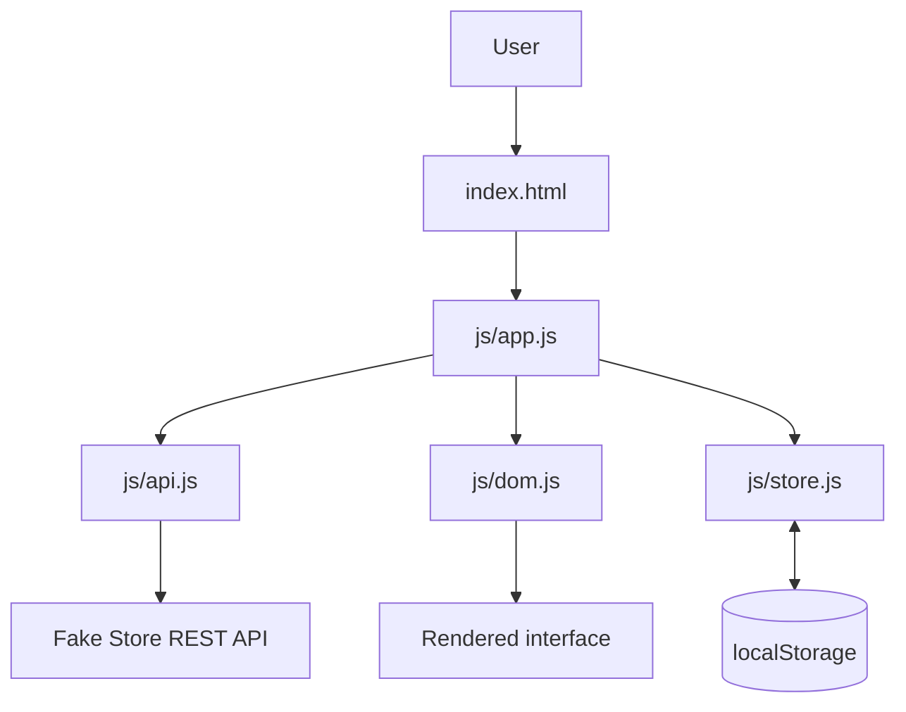

# NovaCart — Production Capstone

A responsive shopping experience built with modular vanilla JavaScript and a public REST API. The capstone demonstrates simulated authentication, dynamic catalog interactions, cart and checkout flows, persistent browser state, loading/error states, and deployment-ready static hosting.

## Feature highlights

- **Simulated sign-in:** capture a display name and email, restore the demo session on reload, and sign out.
- **Interactive catalog:** fetch products asynchronously from Fake Store API; search by title/category, filter by category, and sort by price or rating.
- **Cart and CRUD-style interactions:** add products, increment quantities, remove entries, and calculate totals.
- **Demo checkout and orders:** place a simulated order and view persisted order history.
- **Persistent state:** cart, user session, and order history are saved in localStorage.
- **Resilient UI:** loading skeletons, empty states, and API error banner.
- **Responsive layout:** mobile, tablet, and desktop layouts with semantic landmarks and accessible control labels.

> **Important security note:** Authentication and checkout are intentionally simulations for a front-end capstone. They do not provide account verification, secure sessions, payment processing, or server-side authorization. Do not use real customer data or payment details.

## Architecture



### Module responsibilities

| File | Responsibility |
| --- | --- |
| `index.html` | Semantic app shell, catalog, cart drawer, and sign-in dialog |
| `css/styles.css` | Design tokens, responsive layout, components, and states |
| `js/app.js` | App orchestration, events, filtering, rendering flow, and checkout |
| `js/api.js` | REST API boundary and response validation |
| `js/store.js` | Persistent state and cart/order state transitions |
| `js/dom.js` | HTML rendering helpers and output escaping |

### Data flow

1. `app.js` requests catalog data through `api.js`.
2. `api.js` calls `https://fakestoreapi.com/products` and validates the response.
3. `app.js` applies search, category, and sorting operations.
4. `dom.js` renders escaped product data into the interface.
5. Cart and order actions update `store.js`; `localStorage` persists the state.

## Run locally

No build step or package installation is required.

1. Download or clone this repository.
2. Open the project folder in a terminal.
3. Start a local static server, for example:

   ```bash
   python -m http.server 5500
   ```

4. Open [http://localhost:5500](http://localhost:5500).

Use a local server rather than opening `index.html` directly so JavaScript ES modules work consistently.

## Deploy

This is a static front-end project; the repository root is the publish directory.

### Vercel
1. Import this GitHub repository in Vercel.
2. Select **Other** as the framework preset (or leave the static preset detected).
3. Set **Build Command** to empty and **Output Directory** to `.`.
4. Deploy.

### Netlify
1. Import the repository.
2. Set **Build command** to empty.
3. Set **Publish directory** to `.`.
4. Deploy.

### Cloudflare Pages
1. Connect the repository to Pages.
2. Set **Build command** to empty.
3. Set **Build output directory** to `/`.
4. Deploy.

## Evaluation checklist

- [x] Modular JavaScript architecture
- [x] Async REST API fetch
- [x] Search, category filters, and sorting
- [x] Dynamic cart operations and order creation
- [x] Persistent client-side state
- [x] Loading, empty, and error states
- [x] Responsive interface
- [x] Architecture and setup documentation
- [ ] Live deployment URL added after provider deployment

## Technology

HTML5 · CSS3 · JavaScript ES Modules · Fetch API · Fake Store API · localStorage · Vercel / Netlify / Cloudflare Pages
